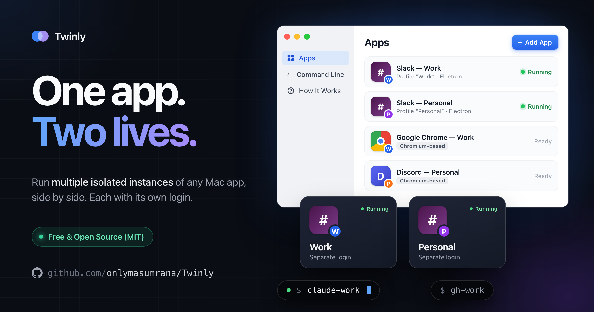

# Twinly 👯‍♂️

> Run multiple separate instances of the same macOS app side-by-side with isolated data, logins, and persistent shortcuts. Free, MIT-licensed, and open-source.



---

## Overview

macOS normally permits only a single running instance per application bundle, and all instances share the exact same user data folder (`~/Library/Application Support/<app>`).

**Twinly** solves this without modifying or resigning original app bundles. It creates native, persistent `.app` wrappers in `~/Applications/Twinly/` that launch clones with isolated data environments. Your shortcuts stay around after closing, appear in Spotlight and Launchpad, and retain separate accounts, cookies, and settings.

Twinly also manages **Command Line** profiles for command-line tools like **Claude Code**, **Codex CLI**, and **GitHub CLI (`gh`)**.

---

## How It Works

| App Architecture | Detection Mechanism | Isolation Strategy | Supported? |
|---|---|---|:---:|
| **Electron / Chromium**<br>*(Claude desktop, Slack, Discord, VS Code, Google Chrome, Brave, Edge)* | `Contents/Frameworks/Electron Framework.framework` or Chromium/Chrome Framework | Binary is launched with `--user-data-dir="<profileDir>"` (and `--profile-directory=Default` for browsers). Complete isolation of cookies, cache, storage, and sessions. | ✅ Yes |
| **Generic Non-Sandboxed Apps**<br>*(Standard Cocoa/AppKit macOS apps)* | Non-Electron, and lacks `com.apple.security.app-sandbox` entitlement | Binary is launched with the `HOME` environment variable redirected to `<profileDir>/home`, with pre-seeded `Library/Application Support`, `Library/Preferences`, and `Library/Caches`. | ✅ Yes |
| **CLI Tools**<br>*(Claude Code, Codex CLI, GitHub CLI, Custom)* | Selected in the Command Line section | Generates an executable shell wrapper in `~/.local/bin/<alias>` configuring tool-specific environment variables (`CLAUDE_CONFIG_DIR`, `CODEX_HOME`, `GH_CONFIG_DIR`) before `exec`ing the real binary. | ✅ Yes |
| **Sandboxed / App Store Apps**<br>*(Pages, Keynote, Mac App Store purchases)* | Has `com.apple.security.app-sandbox` entitlement | **Not Supported.** macOS kernel strictly locks sandbox data containers to the exact bundle ID and Team ID. Twinly detects and flags them with an explanatory warning. | ❌ Unsupported |

---

## Features

- **Persistent Shortcuts (`.app` wrappers):** Real `.app` bundles placed in `~/Applications/Twinly/`. They don't vanish when closed and survive system reboots.
- **Spotlight & Launchpad Ready:** Automatically registered with macOS LaunchServices (`lsregister`) and ad-hoc signed.
- **Custom Visual Badges:** Distinct colored badge (8+ palette colors or custom picker) and custom glyph/text ("2", "Work", emoji) drawn directly onto the original app's `.icns`.
- **Zero App Modification:** Points to the original application by path. App updates to the original bundle continue to work automatically.
- **Safe Deletion:** Deleting a profile removes the shortcut and asks whether to keep or erase its data.
- **Editing:** Rename a profile, change its badge, launch arguments or environment. Logins and data are kept.
- **Repair All Shortcuts:** Rebuilds every shortcut after an app moves or Twinly updates (Settings › Storage, or File menu). Logins and data are kept.
- **Open at login and menu bar:** Optional, in Settings (⌘,).
- **Command Line profiles:** Generates commands like `claude-work`, with a PATH check against your login shell and a copyable fix.
- **Menu Bar Companion:** Quick launcher in the macOS menu bar to trigger any profile instantly.

---

## Architecture

```
Twinly/
├── Sources/
│   ├── Twinly/               # SwiftUI macOS Application
│   │   ├── Views/            # Apps/, CommandLine/, Settings/, Shared/, HowItWorksView, MainContentView
│   │   ├── UIState.swift     # Selection, sheets, alerts and shared actions
│   │   ├── TwinlyCommands.swift  # Menu commands and shortcuts
│   │   └── TwinlyApp.swift   # Main window, Settings and MenuBarExtra scenes
│   ├── TwinlyCore/           # Core Framework
│   │   ├── Models/           # Profile, CLIProfile, AppStrategy, LauncherConfig
│   │   ├── Inspector/        # AppInspector (framework detection & codesign entitlement check)
│   │   ├── Builders/         # WrapperBuilder, IconBadgeGenerator, CLIWrapperBuilder
│   │   ├── Support/          # ShellEnvironment, InputParsing, ProfileStatus
│   │   └── Store/            # ProfileStore (JSON persistence & LaunchServices management)
│   └── TwinlyLauncher/       # Lightweight compiled Swift launcher embedded into wrappers
├── Tests/
│   └── TwinlyTests/          # Test suite (make test)
├── Resources/                # Info.plist, AppIcon.icns
├── Makefile                  # make build, make test, make app, make dmg
├── LICENSE                   # MIT License
└── README.md
```

### The Persistent Shortcut Bundle

Each generated shortcut at `~/Applications/Twinly/<App Name> (<Profile>).app` contains:
- `Contents/Info.plist`: Unique `CFBundleIdentifier` (`io.twinly.<sanitized-orig-id>.<profile-slug>`), custom display name, and `LSUIElement` = false.
- `Contents/MacOS/launcher`: A tiny compiled Swift binary that reads `twinly.json` and launches the target binary with isolated args/environment. If the original app is moved or deleted, it displays a native macOS alert dialog.
- `Contents/Resources/twinly.json`: Configuration specifying original app path, strategy, and extra parameters.
- `Contents/Resources/AppIcon.icns`: The badged icon rendered in all standard macOS resolutions (16x16 through 1024x1024).

---

## Installation & First Launch

### Option 1: Homebrew (Recommended)
```bash
brew tap onlymasumrana/tap
brew trust onlymasumrana/tap   # required on Homebrew 7+
brew install --cask twinly
```
*(If macOS Gatekeeper blocks first launch, run `xattr -dr com.apple.quarantine "/Applications/Twinly.app"` or right-click `Twinly.app` in `/Applications` and click **Open**.)*

### Option 2: Download Pre-built DMG
1. Download `Twinly.dmg` from the [Releases](https://github.com/onlymasumrana/Twinly/releases) page.
2. Open the DMG and drag **Twinly** to your `/Applications` folder.
3. **First-time Gatekeeper Bypass:** Because Twinly is free open-source software distributed outside the Mac App Store:
   - **Right-click** (or Control-click) `Twinly.app` in `/Applications`
   - Select **Open** from the context menu
   - Click **Open** on the confirmation prompt
   - Subsequent launches open normally with a double-click!

### Option 3: Build from Source
```bash
git clone https://github.com/onlymasumrana/Twinly.git
cd twinly

# Build release binaries
make build

# Run unit tests
make test

# Generate Twinly.app bundle in build/
make app

# Package DMG installer in build/Twinly.dmg
make dmg
```

---

## Acceptance Testing & Verification

Twinly includes an automated test suite (`make test`) verifying:
1. **AppInspector:** Correctly detects Electron frameworks, Chromium frameworks, generic Cocoa apps, and Sandboxed apps (tested against real system apps including `/Applications/Claude.app`, `/Applications/Google Chrome.app`, and `/Applications/Pages.app`).
2. **IconBadgeGenerator:** Builds multi-resolution `.icns` files using `iconutil`.
3. **WrapperBuilder:** Creates complete, valid `.app` wrappers, writes `twinly.json`, ad-hoc codesigns the bundle, and registers with `lsregister`.
4. **CLIWrapperBuilder:** Generates POSIX-compliant executable wrapper scripts with correct environment exports and execution permissions.
5. **ProfileStore:** Full lifecycle persistence, updating, and safe deletion.

To run the test suite:
```bash
make test
```

---

## Known Limitations & FAQ

### 1. Keychain Sharing
* **How it works:** Some macOS apps store authentication credentials inside the macOS Keychain using a fixed service name rather than scoping them to their data folder.
* **Impact:** If an app exclusively relies on an unscoped Keychain entry, multiple instances may read from that shared Keychain item.
* **Findings:**
  - **Claude Code CLI:** Stores authentication tokens and configuration under `CLAUDE_CONFIG_DIR`, ensuring 100% separate logins across profiles.
  - **Chromium / Electron Browsers:** Profile data, cookies, and local session stores are isolated by `--user-data-dir`.
  - **VS Code:** Extensions, settings, workspace storage, and credentials stored in SQLite are isolated.

### 2. Dock Icon & Process Representation
* When an isolated wrapper launches, it starts the original app binary. macOS WindowServer links the running process to the original bundle ID, meaning the active Dock tile typically displays the original app's icon.
* However, your shortcut in **Finder**, **Spotlight**, **Launchpad**, and **Dock persistent shortcuts** always shows your custom colored badge and profile label.

### 3. Sandboxed Apps (Mac App Store)
* Apps with the `com.apple.security.app-sandbox` entitlement cannot be cloned because macOS kernel sandbox rules restrict their container folders to `~/Library/Containers/<bundle-id>`. Modifying this requires resigning and modifying the original bundle, which violates Twinly's zero-tamper policy.

### 4. Single-Instance Locks
* Most Electron and Chromium apps enforce single-instance checks using a Unix socket or lock file located inside their user data directory (`SingletonLock` / `SingletonSocket`). Because Twinly supplies a distinct `--user-data-dir`, each instance operates its own socket without collision.

---

## Stretch Goals (Roadmap)

- [x] Separate Dock icons via APFS copy-on-write (with automatic background sync)
- [x] Built-in GitHub Releases auto-updater
- [x] Homebrew Cask formula (`brew install --cask onlymasumrana/tap/twinly`)
- [ ] Profile export and import (sync profiles across Macs)
- [ ] Per-profile proxy and VPN environment presets
- [ ] Apple Developer ID notarization pipeline

---

## License

MIT License. See [LICENSE](LICENSE) for details.
